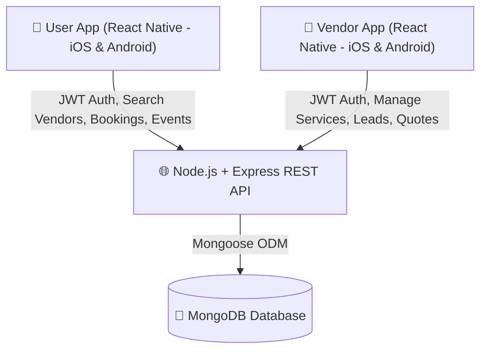

# System Architecture & API Endpoints

## 1. System Architecture Overview

---

## 2. API Endpoints Map

### Auth Endpoints
- `POST /api/auth/user/register` — User registration
- `POST /api/auth/user/login` — User login (returns JWT)
- `POST /api/auth/vendor/register` — Vendor registration
- `POST /api/auth/vendor/login` — Vendor login (returns JWT)

### User Endpoints
- `GET /api/users/profile` — Get logged-in user profile
- `PUT /api/users/profile` — Update user profile

### Vendor Endpoints
- `GET /api/vendors` — Public: Browse/Search vendors (query params: `category`, `city`, `minPrice`, `maxPrice`, `search`)
- `GET /api/vendors/:id` — Public: Get vendor profile with portfolio & services
- `PUT /api/vendors/profile` — Vendor only: Update vendor profile, services & portfolio
- `GET /api/vendors/stats/dashboard` — Vendor only: Get stats (total leads, revenue, bookings)

### Event Endpoints (User)
- `POST /api/events` — Create a new event
- `GET /api/events` — Get all events created by logged-in user
- `GET /api/events/:id` — Get single event details
- `PUT /api/events/:id` — Update event details
- `DELETE /api/events/:id` — Delete event

### Booking & Dynamic Estimate Endpoints
- `POST /api/bookings/calculate-estimate` — Real-time dynamic quotation generator (calculates subtotal, taxes, advance, and total without saving)
- `POST /api/bookings` — Submit final booking/quote request (Single service, Full Planner package, or Orchestra/Celebrity)
- `GET /api/bookings/user` — User gets their bookings & estimates
- `GET /api/bookings/vendor` — Vendor gets incoming booking requests & leads
- `PATCH /api/bookings/:id/status` — Update booking status (`accepted`, `rejected`, `completed`, `cancelled`)
- `PUT /api/bookings/:id/vendor-quote` — Vendor updates/adjusts custom quote amount or remarks

### Reviews Endpoints
- `POST /api/reviews` — User posts a review for a completed booking
- `GET /api/reviews/vendor/:vendorId` — Get reviews for a vendor

