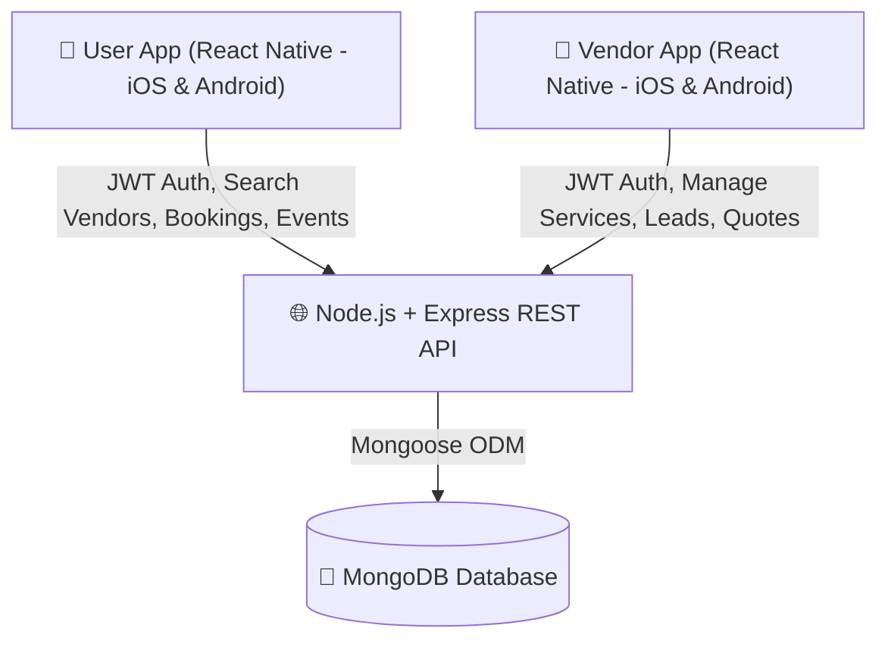

# System Architecture & API Endpoints

## 1. System Architecture Overview



---

## 2. API Endpoints Map

### Auth Endpoints
- `POST /api/auth/user/register` — User registration
- `POST /api/auth/user/login` — User login (returns JWT)
- `POST /api/auth/user/google` — Verify a Google ID token and issue a customer JWT
- `POST /api/auth/user/apple` — Verify an Apple ID token and nonce and issue a customer JWT
- `POST /api/auth/user/forgot-password` — Email a 15-minute, single-use password reset link when SMTP is configured
- `POST /api/auth/user/reset-password` — Replace a password with a valid reset token
- `POST /api/auth/vendor/register` — Vendor registration
- `POST /api/auth/vendor/login` — Vendor login (returns JWT)

### User Endpoints
- `GET /api/users/me` — Get logged-in user profile
- `PATCH /api/users/me` — Update user profile
- `GET /api/users/me/saved-vendors` — List saved vendors
- `PUT /api/users/me/saved-vendors/:id` — Save a vendor
- `DELETE /api/users/me/saved-vendors/:id` — Remove a saved vendor

### Vendor Endpoints
- `GET /api/vendors` — Public: Browse/Search vendors (query params: `category`, `city`, `occasion`, `minPrice`, `maxPrice`, `search`). Known occasion search phrases and aliases, such as Marriage/Wedding and Ring Ceremony/Engagement, rank matching vendors first; the response includes `matchedOccasion`.
- `GET /api/vendors/:id` — Public: Get vendor profile with the full portfolio and services; optional `occasion` ranks relevant services first
- `PUT /api/vendors/profile` — Vendor only: Update vendor profile, services & portfolio
- `GET /api/vendors/:id/reviews` — Public reviews for a vendor
- `POST /api/vendors/:id/reviews` — Customer review after a completed booking

### Event Endpoints (User)
- `POST /api/events` — Create a new event
- `GET /api/events` — Get all events created by logged-in user
- `GET /api/events/:id` — Get single event details
- `PUT /api/events/:id` — Update event details
- `DELETE /api/events/:id` — Delete event
- `POST /api/events/:id/checklist` — Add checklist item
- `PATCH /api/events/:id/checklist/:itemId` — Edit or complete checklist item
- `DELETE /api/events/:id/checklist/:itemId` — Remove checklist item

### Booking & Dynamic Estimate Endpoints
- `POST /api/bookings/calculate-estimate` — Real-time dynamic quotation generator (calculates subtotal, taxes, advance, and total without saving)
- `POST /api/bookings` — Submit final booking/quote request (Single service, Full Planner package, or Orchestra/Celebrity)
- `GET /api/bookings/user` — User gets their bookings & estimates
- `GET /api/bookings/user/:id` — User gets a booking detail
- `PATCH /api/bookings/user/:id/cancel` — User cancels a pending booking
- `GET /api/bookings/vendor` — Vendor gets incoming booking requests & leads
- `PATCH /api/bookings/:id/status` — Update booking status (`accepted`, `rejected`, `completed`, `cancelled`)

#### Implemented estimate request contract

`POST /api/bookings/calculate-estimate` requires a user Bearer token and a body such as:

```json
{
  "vendorId": "<vendor ObjectId>",
  "bookingType": "full_event_package",
  "occasion": "Birthday",
  "selectedServices": [{ "serviceId": "<service ObjectId>", "quantity": 200, "requirements": { "menu": "Vegetarian", "requests": "Nut-free options" } }],
  "selectedCelebrities": [{ "artistId": "<artist ObjectId>", "requirements": { "start": "18:00", "requests": "Acoustic set" } }]
}
```

Use `quantity` for plates, hours, or days according to each catalog item's `pricingType`; fixed and per-event items require quantity 1. The server resolves all prices from the vendor catalog. The response includes itemized services and artists, subtotal, discount (currently zero), tax amount, total, advance, pending amount, configured rates, and `quoteFingerprint`. `POST /api/bookings` accepts the same selections plus `eventDate`, `eventLocation`, and optional `eventId`, `eventTime`, `userNotes`, `expectedQuoteFingerprint`, and UUID `requestKey`; it recalculates prices before saving. A changed fingerprint returns HTTP 409 with the new estimate for review. A repeated request key with identical details returns the original booking. A booking linked to an Event must use that Event's date and city. Rates come from `ESTIMATE_TAX_RATE` (default 0) and `ESTIMATE_ADVANCE_RATE` (default 0.2). A tax rate of zero is intentional until a jurisdiction-specific policy is configured. The advance is an estimate of the requested payment, not a recorded payment.

`occasion` and each selection's `requirements` are optional additions. Requirements accept the documented keys in `DATABASE_SCHEMA.md`, trim values and reject unknown keys, non-string values, overlong text and invalid requested times. They are included in the quote fingerprint, persisted with the price snapshot, and returned in both customer bookings and vendor leads. They express customer preferences and do not change catalog pricing. `eventId` is optional for both single and multiple service requests. Only the explicit event-planning flow creates an Event; switching the selection mode does not.

`Event.eventType` now accepts any nonempty occasion name up to 100 characters. The normalized `occasionKey` supports common aliases while preserving the customer's wording. Vendor profiles accept `supportedOccasionKeys` and `acceptsCustomOccasions`; legacy vendors remain discoverable for custom occasions.

Vendor catalog updates use `PUT /api/vendors/profile`. Supplied `services` and `artistsOrCelebrities` arrays replace their current arrays; retain item `_id` values when editing existing entries. The seed script is disabled in production and requires `SEED_PASSWORD`.

Google and Apple sign-in require configured native client identifiers and platform credentials. The backend verifies provider identity tokens against each provider's public keys before issuing its own JWT. Apple sign-in is available only on iOS in the customer app.

