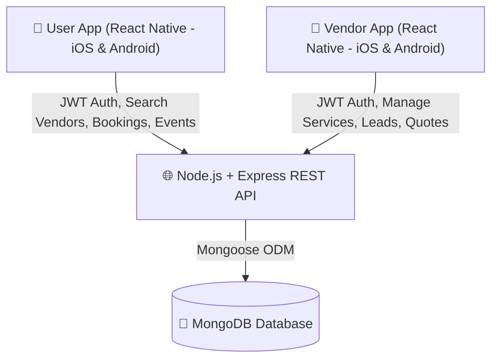

# System Architecture & API Endpoints

## 1. System Architecture Overview



---

## 2. API Endpoints Map

### Auth Endpoints
- `POST /api/auth/user/register` — User registration
- `POST /api/auth/user/login` — User login (returns JWT)
- `POST /api/auth/vendor/register` — Vendor registration
- `POST /api/auth/vendor/login` — Vendor login (returns JWT)

### User Endpoints
- `GET /api/users/profile` — Get logged-in user profile
- `PUT /api/users/profile` — Update user profile

### Vendor Endpoints
- `GET /api/vendors` — Public: Browse/Search vendors (query params: `category`, `city`, `minPrice`, `maxPrice`, `search`)
- `GET /api/vendors/:id` — Public: Get vendor profile with portfolio & services
- `PUT /api/vendors/profile` — Vendor only: Update vendor profile, services & portfolio
- `GET /api/vendors/stats/dashboard` — Vendor only: Get stats (total leads, revenue, bookings)

### Event Endpoints (User)
- `POST /api/events` — Create a new event
- `GET /api/events` — Get all events created by logged-in user
- `GET /api/events/:id` — Get single event details
- `PUT /api/events/:id` — Update event details
- `DELETE /api/events/:id` — Delete event

### Booking & Dynamic Estimate Endpoints
- `POST /api/bookings/calculate-estimate` — Real-time dynamic quotation generator (calculates subtotal, taxes, advance, and total without saving)
- `POST /api/bookings` — Submit final booking/quote request (Single service, Full Planner package, or Orchestra/Celebrity)
- `GET /api/bookings/user` — User gets their bookings & estimates
- `GET /api/bookings/vendor` — Vendor gets incoming booking requests & leads
- `PATCH /api/bookings/:id/status` — Update booking status (`accepted`, `rejected`, `completed`, `cancelled`)
- `PUT /api/bookings/:id/vendor-quote` — Vendor updates/adjusts custom quote amount or remarks

#### Implemented estimate request contract

`POST /api/bookings/calculate-estimate` requires a user Bearer token and a body such as:

```json
{
  "vendorId": "<vendor ObjectId>",
  "bookingType": "full_event_package",
  "selectedServices": [{ "serviceId": "<service ObjectId>", "quantity": 200 }],
  "selectedCelebrities": [{ "artistId": "<artist ObjectId>" }]
}
```

Use `quantity` for plates, hours, or days according to each catalog item's `pricingType`; fixed and per-event items require quantity 1. The server resolves all prices from the vendor catalog. The response includes itemized services and artists, subtotal, discount (currently zero), tax amount, total, advance, pending amount, and configured rates. `POST /api/bookings` accepts the same selections plus `eventDate`, `eventLocation`, and optional `eventId`, `eventTime`, and `userNotes`; it recalculates prices before saving. Rates come from `ESTIMATE_TAX_RATE` (default 0) and `ESTIMATE_ADVANCE_RATE` (default 0.2). A tax rate of zero is intentional until a jurisdiction-specific policy is configured. The advance is an estimate of the requested payment, not a recorded payment.

Vendor catalog updates use `PUT /api/vendors/profile`. Supplied `services` and `artistsOrCelebrities` arrays replace their current arrays; retain item `_id` values when editing existing entries. The seed script is disabled in production and requires `SEED_PASSWORD`.

### Reviews Endpoints
- `POST /api/reviews` — User posts a review for a completed booking
- `GET /api/reviews/vendor/:vendorId` — Get reviews for a vendor

