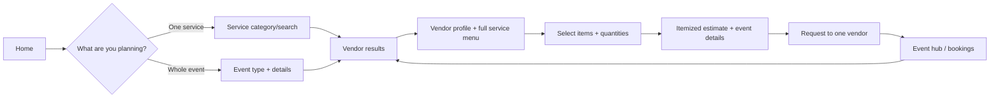

# Flexible Event Booking: Product, UX, and Architecture Design

Status: core customer and backend flow implemented; vendor app, real availability, counter-quotes, payments, and full device interaction QA remain. Updated 2026-10-26.

## 1. Customer promise and scope

A customer can book **one service** (for example, one photographer) or plan **any occasion with a chosen vendor** (for example, a wedding, birthday, engagement/ring ceremony, reception, baby shower, cultural function, conference, concert, or a customer-defined event). The occasion list is open ended. Opening a vendor shows **all** services that vendor lists; relevant services appear first, without hiding the rest. The customer selects only what they need, sees a server-calculated itemized estimate, and sends a booking request.

One event can also hold separate bookings with several vendors. These remain separate vendor requests and estimates. The product must never imply that one planner owns an independent vendor's booking or that an entire event is confirmed when only some requests have been accepted.

The current product sends booking requests; it does not collect payment or guarantee availability. Use “Request booking” and “Estimated total” until the vendor confirms. “Advance requested” is an estimate, not a payment receipt.

## 2. Mental model

| Concept | Meaning | Existing record |
| --- | --- | --- |
| Event | Customer's occasion, date, location, guests, budget, checklist | `Event` |
| Vendor | One business that can offer services for specified event types | `Vendor` |
| Service | A selectable item from that vendor, with a pricing unit | Embedded `Vendor.services` |
| Booking | One request to one vendor for selected services/artists at an event | `Booking` |
| Estimate | Server price calculation at selection time | Existing estimate service |

**Occasion** (wedding/marriage, ring ceremony/engagement, birthday, or anything else) describes what the customer is organizing. **Vendor type** (Catering, Photography, etc.) describes the business. They must be separate filters. Preset occasion suggestions are navigation aids, not an exhaustive or required enum. The customer's exact custom occasion label must be preserved. A caterer or planner can serve many occasions.

## 3. Main journeys

### A. Book one service

1. Home → “Book a service” → choose service category or search.
2. Set city/date if known → see matching vendors. Date filters only when actual availability data exists; otherwise say “Ask vendor about availability.”
3. Open vendor → see photos, service menu, pricing units, location and reviews.
4. Select exactly one service, enter quantity if needed, date and location.
5. Review itemized estimate → **Request this service**.
6. Booking detail shows request status, included item, vendor contact and cancellation rules.

The customer can still pick one service from an Event Planner's menu. Vendor category must not silently turn this into a full-event booking.

### B. Plan any occasion with one vendor

1. Home → “Plan an event” → pick a suggested occasion **or type any event name**, then add city, date, guest count and optional budget. Examples: Marriage, Ring Ceremony, Birthday, Anniversary, Puja, School Function, Corporate Launch. Suggestions can grow without blocking custom input.
2. Show vendors who advertise the occasion, plus general event vendors who accept custom requests. Cards show vendor type, starting price, location, gallery image and “View services.” A vendor with no explicit tag is not silently excluded. Do not claim date availability without a calendar.
3. Vendor detail opens with services relevant to the occasion first. All other listed services remain accessible under “More from this vendor.” For an unrecognized custom occasion, show the full menu and an “Ask this vendor” option rather than an empty result.
4. Customer chooses decor, catering, music, photography, venue, artists, or only a subset. Each service card shows its unit (per plate/hour/day/event), inclusions and quantity control. Artist add-ons appear when supplied.
5. A persistent summary shows selected count and estimated total. “Review plan” opens an itemized review with event details, inclusions, exclusions, notes, advance estimate, and request terms.
6. **Request event booking** creates one booking for that vendor, linked to the customer's Event. The receipt says “Request sent; awaiting vendor response.”

Example for a ring ceremony: 60 guests × ₹650 vegetarian buffet + ₹18,000 floral backdrop + ₹20,000 DJ set = ₹77,000 before configured tax. The same selection flow works for any occasion. This is illustrative; the backend must use current catalog prices and configured tax/advance rates.

### C. Plan an event with several vendors

The customer creates one Event, then adds separate vendor bookings under it. Event detail groups them by vendor and status, shows an estimated sum of current booking requests, and flags services still missing from the customer's own checklist. A planner package and independent bookings may coexist, but the UI must warn about overlapping services before submission. No cross-vendor checkout or combined acceptance is implied.

## 4. Screen structure

### UX details

- Keep the two entry actions visible on Home. Search can recognize aliases such as “marriage”/“wedding” and “ring ceremony”/“engagement,” while preserving the user's words in the event title. Show any suggested occasion filter as an editable chip; never force an unrecognized phrase into “Other.”
- Preserve occasion name, date, city and guest count when moving among results, vendor profile and builder. Allow edits without clearing selections unnecessarily.
- On vendor detail, show the full menu; group and rank by relevance rather than hiding services. Label unsupported or unavailable options honestly.
- Use checkbox controls for independent services and a quantity field only when pricing needs it. Show the unit beside the price, for example “₹650 per plate.”
- Show the estimate update after selection; while the request is pending, show “Calculating…” and disable submit. If repricing changes the amount, require the customer to review the new total.
- Use “Request booking” for the primary action. Confirmation must state that payment was not collected and the vendor has not accepted yet.
- Support empty, loading and error states: no matching vendors, vendor with no services, removed service, unavailable artist, invalid quantity, changed price, and failed network request.
- Make selection controls screen-reader accessible, keep target sizes comfortable, and keep summary/CTA visible above safe areas and the keyboard on Android and iOS.

## 5. Data and API changes proposed

### Vendor catalog

Use an extensible occasion taxonomy: a small set of normalized keys for common suggestions and aliases, plus arbitrary customer labels. `supportedOccasionKeys: [String]` and `acceptsCustomOccasions: Boolean` are implemented on Vendor; optional `occasionKeys` on each service control relevance ordering. An empty service tag list follows the vendor's coverage. Optional `serviceCategory`, structured inclusions, and minimum quantities remain future catalog work. Existing services continue to work with defaults. Vendor ownership and validation remain server-side.

`GET /api/vendors` accepts optional `occasion`, and known occasion phrases in `search` are recognized. Normalize known aliases for ranking, not for rejecting input. Explicit occasion matches rank ahead of vendors accepting custom occasions. Allow city/category search even when the occasion is novel. Vendor detail returns the full service menu with relevant services first; no services are silently filtered out. Normalized vendor tags and city are indexed. A dedicated `serviceCategory` filter remains future work.

### Event and booking

Keep `Event` as the customer's umbrella record and `Booking` as one vendor request. `Event.eventType` now preserves an open-ended occasion label, and `occasionKey` stores a normalized key for common aliases. Existing enum values remain valid. Link a full-event request to an `eventId`; for a one-off service, an `eventId` can remain optional. Keep selected service names, units and prices as a snapshot in Booking so later catalog edits do not rewrite the agreement. MongoDB recommends embedding data read together; this fits the existing booking snapshot, while vendor and event stay referenced entities. [MongoDB embedding guidance](https://www.mongodb.com/docs/manual/data-modeling/embedding/).

Make booking intent explicit in the client instead of deriving it from item count or vendor type. Existing `bookingType` can represent `single_service`, `full_event_package`, or `orchestra_celebrity`; the UI should send the customer's chosen intent and the server should validate compatible selections. For a “whole event” request, require at least one selected service and event details, but do not label it “complete coverage” merely because it has multiple services.

The estimate endpoint remains server authoritative. At submission, recalculate from the vendor catalog, compare the price/version shown to the customer, and return a reviewable price-changed response if they differ. Use an idempotency key for request submission so retries do not create duplicate bookings. Availability, slot holds, vendor counter-quotes, cancellation policy and actual payment are separate capabilities that require explicit contracts and UI before making claims about them.

### Vendor workflow

Vendor setup asks: “Which events do you serve?” followed by service entries with event relevance, pricing unit, inclusions, photos and optional quantity rules. Lead detail presents date, venue, guest count, selected items, notes and the price snapshot. Vendor can accept/reject under the current status workflow; a counter-quote is a future step and must not be simulated in the customer app.

## 6. Current implementation gaps

| Area | Current state | Needed for this design |
| --- | --- | --- |
| One or several services | Explicit customer choice, server estimate and request review implemented | Full device interaction QA |
| Any-occasion discovery | Alias matching, vendor tags, general-vendor fallback and ranking implemented | Broader localization and vendor-maintained tags in vendor app |
| Custom event names | Open-ended `eventType` and normalized `occasionKey` implemented | Broader migration review of existing records |
| Full vendor menu | All services remain visible; tagged services rank first | Structured inclusions and service categories |
| Event linkage | Event-first flow and separate bookings under one Event implemented | Overlap warning for duplicate service coverage |
| Booking type | Customer chooses one service or event services | Full device interaction QA |
| Pricing | Server quote fingerprint, changed-price response and idempotent request key implemented | Vendor counter-quote workflow |
| Availability and payment | No verified availability or collection | Honest pending states; implement separately |
| Vendor app | Not started | Catalog management and lead handling |

## 7. Delivery sequence and acceptance

1. **Occasion model:** add open-ended occasion labels, common aliases and a migration path from the current enum. Verify Marriage/Wedding and Ring Ceremony/Engagement map for discovery, while an unknown custom event can still be saved and searched.
2. **Catalog semantics:** add vendor occasion tags, custom-occasion acceptance and service relevance; migrate demo vendors; verify several preset and custom occasions return useful results and every vendor detail still includes its full menu.
3. **Discovery:** add Plan an event / Book a service entry points, structured filters and persistent context; verify navigation and empty states on Android and iOS.
4. **Builder:** explicit intent, selected items, quantity rules, live server estimate and itemized review; verify one service from an Event Planner remains a one-service request.
5. **Submission:** price-change handling, idempotency, event association and accurate request confirmation; verify no duplicate requests on retries and no false payment or acceptance claim.
6. **Event hub and vendor side:** show separate vendor requests under one Event; build vendor catalog and lead screens; verify request → accept/reject → customer status on both platforms.

Acceptance scenarios:

- A customer searches “Marriage” in Pune and finds vendors tagged Wedding, then chooses catering and decor from a planner's full service list and sends one request.
- A customer enters “Ring Ceremony,” sees matching and general-purpose vendors, selects 60 plates of catering plus decor, and saves that exact occasion name on their Event.
- A customer enters a new occasion the system has never seen, finds general-purpose vendors, sees every service from a chosen vendor, and can send a request with the custom occasion name intact.
- Each Event can also hold a separate photographer request with its own status and price. Selecting just one service from any planner sends a single-service request.
